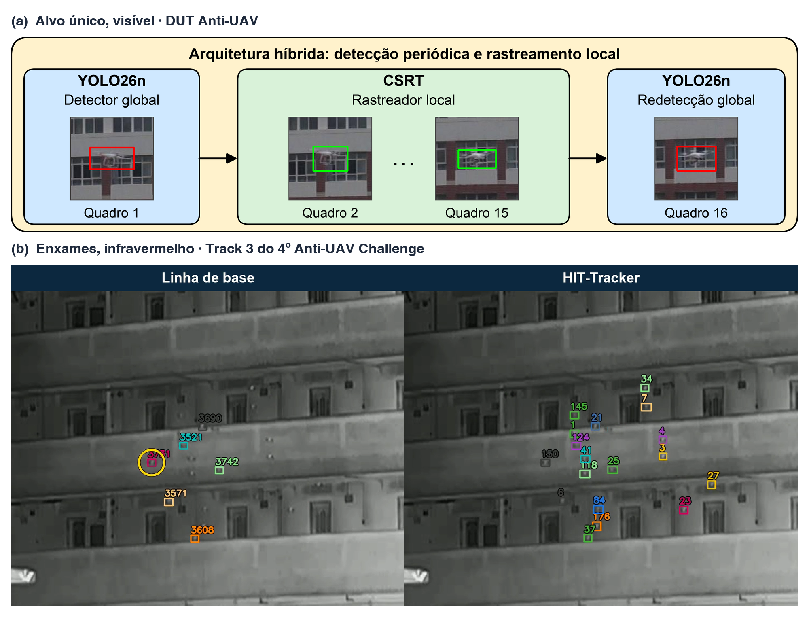
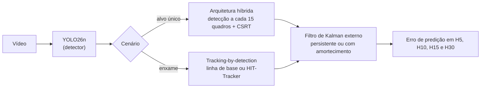

# Rastreamento de drones usando visão computacional e redes neurais profundas

**Avaliação de arquiteturas leves em múltiplos cenários**

Trabalho de Conclusão de Curso de **1º Ten Ighor de Souza Ribeiro**, Curso de Aperfeiçoamento Avançado em Sistema de
Armas (CApA-Of 2026), Centro de Instrução Almirante Alexandrino (CIAA), Marinha do Brasil.
Orientadores: **ETM Rigel Procópio Fernandes, D.Sc.** (DSAM) e **Prof. Marco Antônio Grivet Mattoso Maia, Ph.D.** (PUC-Rio).


> **English summary.** This repository holds the code, per-sequence results and figures of a thesis on drone tracking with
> lightweight computer-vision architectures, in two scenarios: a single drone in the visible spectrum (DUT Anti-UAV) and
> swarms in the infrared (Track 3 of the 4th Anti-UAV Challenge).
> A hybrid architecture (periodic YOLO26n detection + local tracking) is compared with tracking-by-detection and
> transformer trackers; swarm tracking is improved by the HIT-Tracker; trajectory prediction with an external Kalman
> filter is evaluated in both scenarios, with an identity-aware error for swarms.
> Main findings: the hybrid architecture is the fastest and gives the most stable predictions for a single target but loses
> its advantage against swarms; tracking metrics do not rank methods by prediction quality; velocity damping is not a
> universal improvement.

<p align="center">
  
</p>

<p align="center"><em>(a) Arquitetura híbrida no DUT Anti-UAV: o YOLO26n detecta nos quadros 1 e 16 e o CSRT acompanha o alvo entre as detecções.
(b) Linha de base (YOLO26n + BoT-SORT) e HIT-Tracker no mesmo quadro de uma sequência do Track 3.</em></p>

## Em uma frase

Arquiteturas leves rastreiam drones com desempenho competitivo, **desde que adequadas ao número de alvos**: a arquitetura
híbrida foi a mais rápida e a que produziu as predições mais estáveis para um único alvo, mas perdeu sua vantagem diante
de enxames, em que detectar em todos os quadros e aprimorar a associação, como no HIT-Tracker, foi o caminho mais eficaz.
Três achados atravessam os dois cenários:

1. **As métricas de rastreamento não ordenaram os métodos quanto à predição.** No alvo único, a arquitetura híbrida ficou
   abaixo de todos os métodos de referência em SA0,5, SR@0,5, IoU média e AUC, mas teve o menor erro médio em H30
   (139,8 px) e a menor dispersão entre sequências: sua vantagem está na ausência de falhas extremas (maior erro médio de uma
   sequência: 306 px, contra 655 px no ODTrack e de 1.142 a 2.059 px nos rastreadores por detecção).
2. **A vantagem de custo da arquitetura híbrida depende do número de alvos** e, potencialmente, da plataforma. No Apple M2,
   com um único alvo, foi a mais rápida (66,4 FPS); nos enxames, o custo do rastreador local cresceu cerca de 33 ms por
   alvo e a arquitetura caiu para 2,6 FPS.
3. **O amortecimento de velocidade não é uma melhoria universal.** No DUT Anti-UAV reduziu o erro em H30 nos nove métodos
   (de 13,2% a 35,5%); no Track 3 não o reduziu em nenhum dos três rastreadores. Além disso, a preservação das identidades
   mostrou-se mais relevante para a classificação atribuída a cada alvo do que para a predição em si.

O texto completo do TCC será vinculado aqui após a publicação pela instituição.

## Mapa dos trabalhos

O TCC integra três trabalhos, cada um com seu repositório, e acrescenta a terceira etapa e as extensões descritas na última coluna.

| Etapa | Cenário | Artigo | Repositório | O que é próprio do TCC |
|---|---|---|---|---|
| 1 | Alvo único, visível (DUT Anti-UAV) | SIGE 2026 | [hybrid-uav-tracking-prediction](https://github.com/IghorRibeiro/hybrid-uav-tracking-prediction) | Escolha do rastreador local pela predição; erro de predição com Kalman externo padronizado, persistente e amortecido; suporte comum; testes pareados |
| 2 | Enxames, infravermelho (Track 3) | LAFusion 2026 (Springer CCIS, a publicar) | [DroneTrackingMOT](https://github.com/IghorRibeiro/DroneTrackingMOT), tag `v1.0-lafusion2026` | Arquitetura híbrida estendida a múltiplos alvos; custo por alvo (hipótese H4) |
| Base de detecção | Detecção de objetos pequenos | WVC 2026 | [yolo26n-seadronessee-postprocessing](https://github.com/IghorRibeiro/yolo26n-seadronessee-postprocessing) | — |
| 3 | Predição de trajetória nos dois cenários | Este TCC | este repositório | Protocolo de predição com identidade em enxames; hipóteses H1 a H4; figuras e tabelas do TCC |

Estrutura: [`etapa1_alvo_unico/`](etapa1_alvo_unico/) e [`etapa2_enxames/`](etapa2_enxames/) apontam para os repositórios dos
artigos, sem duplicar código; [`etapa3_predicao/`](etapa3_predicao/) tem o código próprio; [`stats/`](stats/) os testes;
[`figures/`](figures/) as figuras; [`results/`](results/) os resultados por sequência; [`configs/`](configs/) os parâmetros;
[`tests/`](tests/) os testes de unidade.

## Fluxo



## Resultados principais

Todos os valores abaixo são os do TCC e são recalculados de [`results/`](results/) por `python stats/verify_tcc.py`
(222 números conferidos contra o PDF).

### Etapa 1 — rastreamento de alvo único (DUT Anti-UAV, 20 sequências; FPS no Apple M2)

O YOLO26m superou o YOLO26n em todas as métricas de detecção (mAP@0,5: 0,961 contra 0,944), mas tem cerca de 8,5 vezes mais
parâmetros e exige cerca de 12,6 vezes mais operações por imagem; por isso o YOLO26n foi adotado nos dois cenários.

| Método | SA0,5 | SR@0,5 | IoU média | AUC | FPS |
|---|---|---|---|---|---|
| BoT-SORT | 0,828 | 0,832 | 0,659 | 0,662 | 42,7 |
| DeepSORT | 0,830 | 0,834 | 0,662 | 0,664 | 4,5 |
| ByteTrack | 0,833 | 0,836 | 0,660 | 0,663 | 58,7 |
| OSTrack | 0,803 | 0,831 | 0,668 | 0,672 | 13,7 |
| ODTrack | 0,819 | 0,860 | 0,707 | 0,709 | 7,3 |
| **Híbrido (YOLO26n + CSRT)** | 0,786 | 0,811 | 0,646 | 0,648 | **66,4** |

### Etapa 1 — erro de predição em H30 (1 s à frente; média ± desvio-padrão entre as 20 sequências)

| Método | SR@0,5 | AUC | H30 (px), filtro persistente | Maior erro médio de uma sequência (px) |
|---|---|---|---|---|
| BoT-SORT | 0,832 | 0,662 | 226,2 ± 303,6 | 1.142 |
| DeepSORT | 0,834 | 0,664 | 261,9 ± 446,0 | 1.980 |
| ByteTrack | 0,836 | 0,663 | 270,1 ± 462,9 | 2.059 |
| OSTrack | 0,831 | 0,672 | 204,4 ± 206,3 | 753 |
| ODTrack | 0,860 | 0,709 | 167,4 ± 160,8 | 655 |
| **Híbrido** | 0,811 | 0,648 | **139,8 ± 97,6** | **306** |

Com amortecimento (γ = 0,95) o erro da arquitetura híbrida em H30 caiu de 139,8 para 111,1 px (redução de 20,5%); nenhuma
diferença entre a arquitetura híbrida e os métodos de referência foi significativa após a correção de Holm. Escolha do
rastreador local (H30, filtro persistente): CSRT 139,8 ± 97,6 px, MedianFlow 162,2 ± 126,4, KCF 179,5 ± 189,4 e MOSSE
197,9 ± 248,1; nenhuma comparação com o CSRT foi significativa após Holm.

### Etapa 2 — do BoT-SORT ao HIT-Tracker (Track 3, 30 sequências)

Entre seis rastreadores com o mesmo detector e configurações padrão, o BoT-SORT obteve a maior MOTA e a maior IDF1 e foi
adotado como linha de base (MOTA 76,0%, IDF1 71,2%, 2.355 trocas de identidade). O HIT-Tracker combina
*hard-example mining*, inferência fatiada (recortes de 512 px), custo de Geman-McClure (γ = 0,55) e NSA-Kalman.

| Configuração | MOTA (%) | IDF1 (%) | IDs |
|---|---|---|---|
| Linha de base | 76,0 | 71,2 | 2.355 |
| Geman-McClure + NSA-Kalman | 76,9 | 74,8 | 1.611 |
| Hard-example mining | 76,7 | 71,2 | 2.374 |
| Hard-example mining + SAHI (512 pixels) | 79,6 | 80,3 | 712 |
| **HIT-Tracker** | **79,9** | **82,7** | **494** |

O HIT-Tracker elevou a MOTA em 3,9 pontos percentuais e a IDF1 em 11,5 e reduziu as trocas de identidade em 79,0% em
relação à linha de base, ao custo de reduzir o FPS de 54,8 para 23,0. A comparação com a literatura da Track 3 é apenas
indicativa (partição interna, servidor de avaliação indisponível). As técnicas de pré-processamento de imagem
(MOG2, média móvel exponencial, fluxo óptico denso, CLAHE, correção gama, *unsharp masking* e aguçamento) degradaram o
desempenho e não foram incorporadas.

### Etapa 2 — arquitetura híbrida e custo por número de alvos

| Variante | MOTA (%) | IDF1 (%) | IDs | FN | FPS |
|---|---|---|---|---|---|
| Linha de base | 76,0 | 71,2 | 2.355 | 65.554 | 54,8 |
| HIT-Tracker | 79,9 | 82,7 | 494 | 51.886 | 23,0 |
| Híbrido (CSRT, N_red = 15) | 60,9 | 59,4 | 1.453 | 135.181 | 2,6 |

A regressão do tempo por quadro indicou um acréscimo de **32,9 ms por alvo** na arquitetura híbrida (intervalo de
confiança de 95% de 14,7 a 53,5 ms), contra 0,13 ms na linha de base e 0,06 ms no HIT-Tracker.

### Etapa 3 — predição com identidade no Track 3 (média entre as 30 sequências)

Erro normalizado pela diagonal do alvo; H30 corresponde a 1,2 s.

| Rastreador | Filtro | H5 | H10 | H15 | H30 | H30 (px) |
|---|---|---|---|---|---|---|
| Linha de base | Persistente | 0,192 | 0,406 | 0,662 | 1,613 | 21,8 |
| Linha de base | Amortecido | 0,210 | 0,456 | 0,741 | 1,698 | 24,1 |
| HIT-Tracker | Persistente | 0,190 | 0,401 | 0,656 | 1,601 | 21,4 |
| HIT-Tracker | Amortecido | 0,211 | 0,460 | 0,749 | 1,710 | 24,2 |
| Híbrido | Persistente | 0,224 | 0,443 | 0,698 | 1,630 | 21,3 |
| Híbrido | Amortecido | 0,232 | 0,474 | 0,755 | 1,705 | 23,9 |

### Decisão das hipóteses (seis testes, correção de Holm, nível 0,05 sobre os valores-p ajustados)

| Hipótese | Resultado | Decisão |
|---|---|---|
| H1: o amortecimento reduz o erro em H30 também no Track 3 | diferença pareada de +0,085 (linha de base) e +0,110 (HIT-Tracker); p ajustado 0,26 e 0,24 | não confirmada |
| H2: sequências com maior IDF1 têm menor erro de predição | ρ = −0,29 (linha de base) e −0,28 (HIT-Tracker); p ajustado 0,26 | não confirmada |
| H3: o HIT-Tracker prediz melhor que a linha de base | diferença de −0,045 (IC 95% de −0,082 a −0,025); p ajustado < 0,001; erro de 1,611 para 1,566 diagonais (−2,8%, menos de 1 px) | confirmada |
| H4: o custo da arquitetura híbrida cresce com o número de alvos mais rápido que o da linha de base | diferença de inclinações de 32,7 ms por alvo; p ajustado = 0,001 | confirmada |

O HIT-Tracker reduziu as trocas de identidade em 79,0%, mas o erro de predição caiu em menos de 1 px: as trocas são eventos
pontuais e, no Track 3, o movimento dos alvos é bastante regular. Isso não torna as trocas irrelevantes, porque elas
transferem a classificação atribuída à trilha ao alvo errado, risco que o erro de predição não mede.

Resultados negativos que não precisam ser repetidos estão em [NEGATIVE_RESULTS.md](NEGATIVE_RESULTS.md).

## Protocolo

- **Unidade amostral:** a sequência de vídeo, nos testes e nas médias. DUT Anti-UAV: 20 sequências de rastreamento
  (24.804 quadros, 30 quadros por segundo). Track 3: 30 sequências de validação, vídeos completos, sem subamostragem
  (22.839 quadros e 478.548 caixas, 25 quadros por segundo, 640 × 512 pixels).
- **Equipamento:** Apple M2, escolhido como representativo de computadores sem GPU dedicada, para o rastreamento e a
  predição; ajuste fino dos detectores em uma GPU NVIDIA Tesla T4. Python 3.13, PyTorch 2, Ultralytics 8.4, OpenCV 4 com o
  pacote contrib e SciPy.
- **FPS:** 1.000 dividido pelo tempo médio de processamento por quadro, em milissegundos, medido desde a entrega do quadro já
  decodificado até a saída das caixas, sem a leitura e a decodificação do vídeo. Só é comparável entre métodos de um mesmo
  cenário.
- **Métricas:** SA0,5, SR@0,5, IoU média e AUC (alvo único); MOTA, IDF1, trocas de identidade, FP, FN e FPS (enxames); erro de
  predição em H5, H10, H15 e H30 (0,17 s a 1 s a 30 fps; 0,2 s a 1,2 s a 25 fps).
- **Predição:** Kalman de velocidade constante, Q = 0,03 I, R = 0,1 I, P0 = I; configuração persistente (γ = 1) e com
  amortecimento (γ = 0,95). Nos enxames, a trilha é comparada ao alvo que seguia no instante da predição
  (correspondência do CLEAR MOT, IoU ≥ 0,5), com erro normalizado pela diagonal do alvo e suporte comum entre rastreadores.
- **Estatística:** Wilcoxon pareado bilateral, correlação de Spearman, intervalos de confiança BCa por *bootstrap* com 10.000
  reamostragens das sequências e semente fixa, correção de Holm por família de testes (nível 0,05 sobre os valores-p ajustados).
- **Limitações** (Seção 3.2 do TCC): cada configuração foi executada uma vez, com sementes fixas; os rastreadores baseados em
  Transformers são inicializados pela anotação do primeiro quadro; o cenário de enxames foi avaliado em partição interna; um
  único equipamento; amostras de 20 e 30 sequências; modelo de movimento de velocidade constante no plano da imagem.

## Dados

Os dados **não são redistribuídos** aqui; baixe-os das fontes originais e respeite suas licenças.

| Conjunto | Uso | Fonte |
|---|---|---|
| DUT Anti-UAV (Zhao et al., 2022) | alvo único, visível: detecção (10.000 imagens) e rastreamento (20 sequências) | [github.com/wangdongdut/DUT-Anti-UAV](https://github.com/wangdongdut/DUT-Anti-UAV) |
| Track 3 do 4º Anti-UAV Challenge (China Telecom, 2025) | enxames, infravermelho | DOI [10.5281/zenodo.15103888](https://doi.org/10.5281/zenodo.15103888) |

Aponte a raiz dos dados com `--data-root` ou com a variável de ambiente `TCC_DATA_ROOT`. Estrutura esperada para a Track 3:

```text
$TCC_DATA_ROOT/
└── MultiUAV_Train/
    ├── TrainVideos/MultiUAV-NNN.mp4
    └── original_label_file/UAVNNN/gt/gt.txt
```

Para o DUT Anti-UAV, use a organização exigida pelo código do SIGE (veja [`etapa1_alvo_unico/`](etapa1_alvo_unico/)), com as
anotações oficiais em `Anti-UAV-Tracking-V0GT/videoNN_gt.txt`.

## Reproduzir

```bash
python3.13 -m venv .venv && source .venv/bin/activate
pip install -r requirements.txt            # análise, estatística e figuras
```

**Caminho rápido** (a partir de `results/`, em segundos):

| Tabela ou figura do TCC | Comando | Saída esperada |
|---|---|---|
| Tabelas 4 a 15 e números do texto | `python stats/make_tables.py` | `results/summary.csv` |
| Tabela 3 (H1 a H4) e famílias complementares | `python stats/hypothesis_tests.py` | `results/hypothesis_tests.csv`: H1 p = 0,26 e 0,24; H2 ρ = −0,29 e −0,28; H3 −0,045; H4 32,7 ms/alvo |
| Conferência contra o PDF | `python stats/verify_tcc.py --pdf <TCC.pdf>` | `222 numbers checked, 0 failure(s)` |
| Figuras 4 a 8 | `python figures/make_figures.py` | `figures/out/fig4_…` a `fig8_…` (PDF vetorial e PNG) |
| Testes de unidade | `python -m unittest discover -s tests` | `OK` |
| Capa e pré-visualização social | `python figures/make_hero.py --hybrid-band … --mot-video …` | `assets/hero.png`, `assets/social_preview.png`, `assets/hero.gif` |

As Figuras 1 a 3 do TCC são diagramas e não são geradas por este repositório.

**Caminho completo** (a partir dos vídeos; exige os dados, `pip install -r requirements-inference.txt` e os pesos da seção
seguinte):

```bash
# Etapa 1: trajetórias do alvo único (código do SIGE; veja etapa1_alvo_unico/README.md)
python etapa3_predicao/predict_sot.py --method CSRT \
    --predictions <sige>/avaliacao_tracking/predicoes/hibrido_csrt \
    --gt-dir <sige>/hitratepos/Anti-UAV-Tracking-V0GT --out sot_csrt.csv

# Etapa 2: linha de base e HIT-Tracker (código do LAFusion; veja etapa2_enxames/README.md) e arquitetura híbrida multialvo
python etapa3_predicao/run_hybrid_mot.py --mot-repo <DroneTrackingMOT> --weights best.pt \
    --videos $TCC_DATA_ROOT/MultiUAV_Train/TrainVideos --sequences UAV009 UAV005 --out-dir runs/hybrid_csrt_n15

# Etapa 3: erro de predição com identidade
python etapa3_predicao/predict_mot.py --variant hybrid_csrt_n15 --trajectories runs/hybrid_csrt_n15/traj \
    --out-dir results_mot/hybrid_csrt_n15
```

## Pesos utilizados

Release [`v1.0-tcc2026`](https://github.com/IghorRibeiro/tcc-rastreamento-vant/releases/tag/v1.0-tcc2026) deste repositório
(`SHA256SUMS` no mesmo local). `best.pt` e `best_hardmining.pt` também estão em `weights/` do
[DroneTrackingMOT](https://github.com/IghorRibeiro/DroneTrackingMOT/tree/v1.0-lafusion2026/weights).

| Arquivo | Uso | SHA256 |
|---|---|---|
| `yolo26n_dut_best.pt` | YOLO26n ajustado no DUT Anti-UAV (Etapa 1) | `df22058bd53041f3c7f0fe8d820d03806ca9f2fa18601eadafa32841e5c6b8c0` |
| `best.pt` | YOLO26n ajustado na Track 3, detector original (linha de base e híbrido) | `57d7e51ccf5a9574167bea26ac82898c0f7327929ce112fff43e234cd34be4a2` |
| `best_hardmining.pt` | YOLO26n com *hard-example mining* (HIT-Tracker) | `56a11fac9992c0d9f3bd97f2f324951c40c8e7cda9bfbd794d0e0b81c44cceac` |

## Como citar

```bibtex
@mastersthesis{ribeiro2026rastreamento,
  author    = {Ribeiro, Ighor de Souza},
  title     = {Rastreamento de drones usando vis{\~a}o computacional e redes neurais profundas: avalia{\c{c}}{\~a}o de arquiteturas leves em m{\'u}ltiplos cen{\'a}rios},
  school    = {Centro de Instru{\c{c}}{\~a}o Almirante Alexandrino, Marinha do Brasil},
  type      = {Trabalho de Conclus{\~a}o de Curso (Curso de Aperfei{\c{c}}oamento Avan{\c{c}}ado em Sistema de Armas)},
  address   = {Rio de Janeiro},
  year      = {2026},
  note      = {Orientadores: Rigel Proc{\'o}pio Fernandes e Marco Ant{\^o}nio Grivet Mattoso Maia},
  url       = {https://github.com/IghorRibeiro/tcc-rastreamento-vant}
}

@inproceedings{ribeiro2026sige,
  author    = {Ribeiro, Ighor de Souza and Fernandes, Rigel Proc{\'o}pio and Luna, Gabriel de Sapienza},
  title     = {Arquitetura H{\'i}brida para Rastreamento e Predi{\c{c}}{\~a}o de Trajet{\'o}ria de {VANTs} Baseada em Vis{\~a}o Computacional e Filtro de Kalman},
  booktitle = {Anais do XXVIII Simp{\'o}sio de Aplica{\c{c}}{\~o}es Operacionais em {\'A}reas de Defesa (SIGE)},
  pages     = {138--143},
  publisher = {Instituto Tecnol{\'o}gico de Aeron{\'a}utica},
  address   = {S{\~a}o Jos{\'e} dos Campos},
  year      = {2026},
  issn      = {1983-7402}
}

@inproceedings{ribeiro2026lafusion,
  author    = {Ribeiro, Ighor de Souza and Fernandes, Rigel Proc{\'o}pio and Luna, Gabriel de Sapienza},
  title     = {From Baseline to {HIT-Tracker}: An Experimentally Optimized Pipeline for Infrared Multi-{UAV} Tracking},
  booktitle = {Fourth Latin American Workshop on Information Fusion (LAFusion 2026)},
  series    = {Communications in Computer and Information Science (CCIS)},
  publisher = {Springer},
  year      = {2026},
  note      = {To appear}
}

@inproceedings{ribeiro2026wvc,
  author    = {Ribeiro, Ighor de Souza and Fernandes, Rigel Proc{\'o}pio},
  title     = {Maritime Search and Rescue: An Evaluation of Small-Object Detection in {UAV} Imagery},
  booktitle = {XXI Workshop on Computer Vision (WVC 2026)},
  year      = {2026}
}
```

O arquivo [`CITATION.cff`](CITATION.cff) permite citar pelo botão "Cite this repository" do GitHub.

## Licença

[GNU Affero General Public License v3.0](LICENSE). O código depende da biblioteca Ultralytics (AGPL-3.0), e os repositórios
dos artigos que ele integra (DroneTrackingMOT e o do WVC) já adotam a mesma licença; os avisos de terceiros estão em
[NOTICE](NOTICE). Os conjuntos de dados mantêm suas próprias licenças.

## Agradecimentos

Aos orientadores, ETM Rigel Procópio Fernandes (DSAM) e Prof. Marco Antônio Grivet Mattoso Maia (PUC-Rio), e a Gabriel de
Sapienza Luna, coautor dos artigos SIGE e LAFusion. Aos autores do DUT Anti-UAV (Zhao et al., 2022) e à organização do 4º
Anti-UAV Challenge (China Telecom, 2025), cujos conjuntos públicos tornaram o trabalho possível, e ao Centro de Instrução
Almirante Alexandrino.
